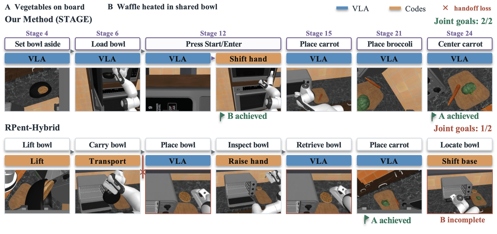
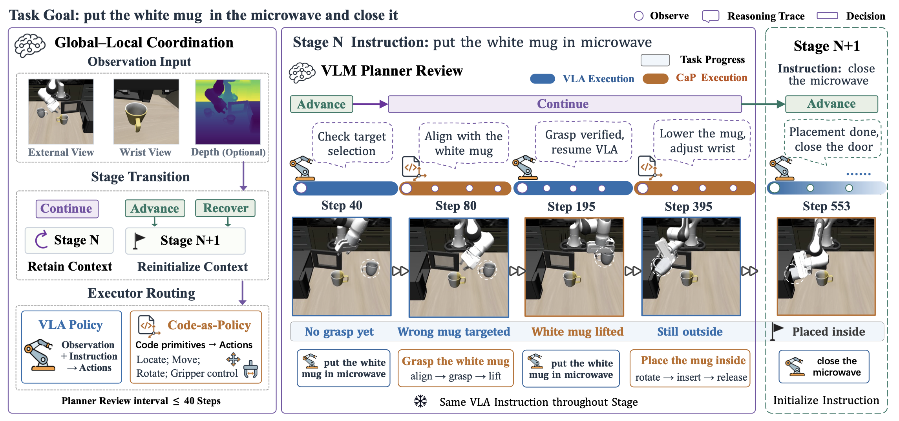
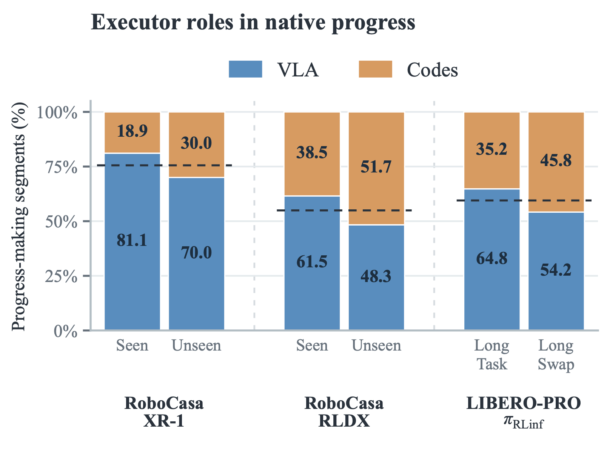
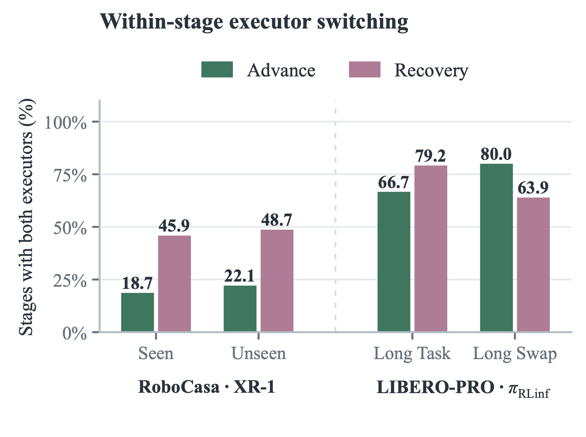
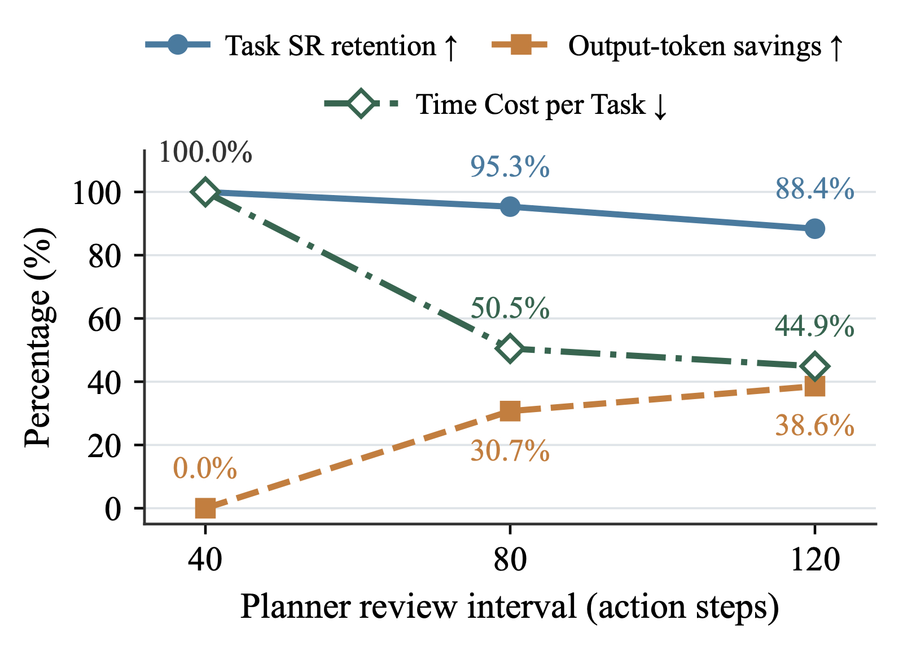

<div align="center">

# Stage by Stage

### Coordinating Vision-Language-Action Policy and Code-as-Policy for Long-Horizon Manipulation

[](https://www.python.org/)
[](https://embodied-manipulation.github.io/stage-robotics/)
[](data/rollouts/README.md)
[](#benchmark-results)
[](stage/backends/cap/LICENSE)

</div>

<p align="center">
  
</p>

> **STAGE** is an inference-time coordination framework for long-horizon robotic manipulation that unites pretrained **Vision-Language-Action (VLA)** policies with **Code-as-Policy (CaP)** analytic programs—without fine-tuning, prior target-task exploration, or cross-episode memory.

---

## Highlights

- **Global–Local Coordination**: Decouples global objective progression from local executor selection. A persistent *stage* contract $g = (\ell, c)$ fixes the active instruction $\ell$ and observable completion criterion $c$, allowing the VLM planner to interleave VLA calls and Code-as-Policy primitives freely within the same unfinished stage.
- **Unified Physical-Action Observation Window**: Tracks motion from both executors under a single shared counter measured in physical simulation action steps (default $W = 40$), returning fresh visual observations for review without treating observation checkpoints as stage boundaries.
- **Selective Context Retention**: Preserves the stage contract and backend-compatible temporal context across same-stage executor handoffs—carrying measured visual/proprioceptive history across code interventions on **RoboCasa365** (XR-1 / RLDX-1), reusing uninterrupted Real-Time Chunking (RTC) action tails on **LIBERO-PRO** ($\pi_{\text{RLinf}}$) while discarding stale tails after code motion—and cleanly reinitializing from the current observation at stage transitions.
- **Zero Prior Exploration or Memory**: Achieves **80.00%** Avg SR on **LIBERO-PRO Long** and **65.00%** Avg SR on **RoboCasa365 Composite** with frozen models and no cross-episode memory.

---

## Method Overview

<p align="center">
  
</p>

At each observation review, the VLM planner evaluates the active stage against its completion condition $c$ and emits a structured transition decision via `subgoal_review` before dispatching subsequent VLA (`vla_skill`, `vla_arm`, `pi0_pick`) or Code-as-Policy (`move_to`, `move_delta`, `set_gripper`, `navigate_to`, etc.) tool calls:

| Decision | Stage Identity | Instruction & Criterion $(\ell, c)$ | Policy Context Handling |
| :--- | :--- | :--- | :--- |
| **`start`** | Creates initial stage ID | Instantiated from task & $o_0$ | Initialize from current observation |
| **`continue`** | Preserves active stage ID | Preserved verbatim | Retain & update backend-compatible context across VLA/CaP handoffs |
| **`advance`** | Creates new stage ID | Replaced upon completion evidence | Clear prior context; reinitialize from current observation |
| **`recover`** | Creates new stage ID (links parent) | Corrective objective for observed blocker | Clear prior context; reinitialize from current observation |

> An executor switch (VLA $\leftrightarrow$ Code) or reaching the observation interval $W$ never forces a stage transition by itself. `finish` records the planner's self-assessment independently of benchmark-native task evaluation.

---

## Benchmark Results

### Main Results (Task Success Rate, %)

#### (a) LIBERO-PRO Long

| Category | Method | VLM (Effort) | Executors | Long Task | Long Swap | **Avg SR** |
| :--- | :--- | :--- | :--- | :---: | :---: | :---: |
| *RSI* | Zetta | GPT-5.6-Sol (high) | $\pi_{0.5}$ + skills | 63.00 | 40.00 | 51.50 |
| *RSI* | HarnessVLA | GPT-6 Astra (low) | $\pi_{\text{RLinf}}$ + CaP | 85.00 | 72.00 | 78.50 |
| *Standalone* | $\pi_{0.5}$ | — | $\pi_{0.5}$ | 1.00 | 8.00 | 4.50 |
| *Standalone* | $\pi_{\text{RLinf}}$ | — | $\pi_{\text{RLinf}}$ | 49.00 | 14.00 | 31.50 |
| *Agentic* | RoboDuo | Qwen3.5-2B | $\pi_{0.5}$ | 50.20 | 15.20 | 32.70 |
| *Agentic* | AgenticRoboRL | Qwen3.5-9B | $\pi_{\text{RLinf}}$ + CaP | 41.00 | 39.00 | 40.00 |
| *Agentic* | RPent-Hybrid* | GPT-6 Astra (low) | $\pi_{\text{RLinf}}$ + CaP | 56.00 | 52.00 | 54.00 |
| *Agentic* | OpenRUA | Fable 5.1 (high) | CaP | 70.00 | **80.00** | 75.00 |
| **Ours** | **STAGE** | **GPT-6 Astra (low)** | **$\pi_{\text{RLinf}}$ + CaP** | **90.00** | 70.00 | **80.00** |

#### (b) RoboCasa365 Composite

| Category | Method | VLM (Effort) | Executors | Seen | Unseen | **Avg SR** |
| :--- | :--- | :--- | :--- | :---: | :---: | :---: |
| *RSI* | AdaRSI | GPT-6.1-sol | GR00T N1.5 | 49.00 | 13.80 | 31.40 |
| *RSI* | HarnessVLA | GPT-6 Astra (high) | RLDX-1 + CaP | 43.75 | 42.50 | 43.13 |
| *Standalone* | RLDX-1 | — | RLDX-1 | 21.30 | 5.00 | 13.15 |
| *Standalone* | XR-1 | — | XR-1 | 57.10 | 32.10 | 44.60 |
| *Agentic* | RPent-Hybrid* | GPT-6 Astra (low) | XR-1 + CaP | 13.75 | 30.00 | 21.88 |
| *Agentic* | OpenRUA | Claude Opus 5 | CaP | 26.30 | 28.10 | 27.20 |
| *Agentic* | Long-WAM | GPT-6 Astra | Long-WAM + CaP | 38.80 | 35.00 | 36.90 |
| **Ours** | **STAGE (RLDX-1)** | **GPT-6 Astra (low)** | **RLDX-1 + CaP** | 36.25 | 35.00 | 35.63 |
| **Ours** | **STAGE (XR-1)** | **GPT-6 Astra (low)** | **XR-1 + CaP** | **76.25** | **53.75** | **65.00** |

### Core Design Ablations (RoboCasa365 Composite Unseen, XR-1)

| Configuration | Task SR (%) | $\Delta$ (pp) |
| :--- | :---: | :---: |
| **STAGE (Full)** | **53.75** | — |
| $-$ Fixed executor per subtask (no within-stage switching) | 36.25 | $-17.50$ |
| $-$ Without context continuity across VLA calls | 35.00 | $-18.75$ |

---

## Analysis & Insights

<table>
  <tr>
    <td width="33%" align="center">
      
      <br><sub><b>Complementary Executor Roles</b>: VLA and Code both drive native progress, adapting to policy strength and task distribution.</sub>
    </td>
    <td width="33%" align="center">
      
      <br><sub><b>Within-Stage Switching</b>: Mixed VLA+Code collaboration occurs frequently inside unfinished stages, especially during recovery.</sub>
    </td>
    <td width="33%" align="center">
      
      <br><sub><b>Review Interval Trade-off</b>: Increasing $W$ from 40 to 80 retains 95.3% Task SR while cutting latency by ~50% and tokens by 30.7%.</sub>
    </td>
  </tr>
</table>

---

## Public Rollouts & Case-Study Video Showcase

### 1. Interactive Case-Study Showcase Page

Rollout videos and interactive stage/executor timelines for the case studies in the main paper and supplementary material are hosted on our **[GitHub Showcase Page](https://embodied-manipulation.github.io/stage-robotics/)** (source in [`docs/`](docs/)):

| Paper Reference | Benchmark / Setting | Task (`seed`) | Comparison | Videos |
| :--- | :--- | :--- | :--- | :--- |
| **Main Paper Fig. 5 (Sec. 5.5)** | Coupled Shared-Object Dependency | `BoardWaffleDependency` (`1758`) | **STAGE** (Joint Success, 4,590 steps) vs. **RPent-Hybrid** (3,627 steps, loses waffle) | [STAGE](docs/videos/board_waffle_stage.mp4) · [RPent](docs/videos/board_waffle_rpent.mp4) |
| **Teaser / Appendix Fig. S3(a)** | Coupled Two-Goal Composition | `BreakfastCoffeeComposition` (`1758`) | **STAGE** (Joint Success, 2,052 steps) vs. **RPent-Hybrid** (1,489 steps, incomplete) | [STAGE](docs/videos/breakfast_coffee_stage.mp4) · [RPent](docs/videos/breakfast_coffee_rpent.mp4) |
| **Appendix Fig. S3(b)** | RoboCasa365 Composite Seen | `PreSoakPan` (`1161`) | **STAGE** (Success, 1,518 steps) vs. **RPent-Hybrid** (858 steps) | [STAGE](docs/videos/rc_seen_presoakpan_stage.mp4) · [RPent](docs/videos/rc_seen_presoakpan_rpent.mp4) |
| **Appendix Fig. S3(c)** | RoboCasa365 Composite Unseen | `ArrangeTea` (`1761`) | **STAGE** (Success, 1,796 steps) vs. **RPent-Hybrid** (1,506 steps) | [STAGE](docs/videos/rc_unseen_arrangetea_stage.mp4) · [RPent](docs/videos/rc_unseen_arrangetea_rpent.mp4) |
| **Handoff Trace C08** | RoboCasa365 Composite Unseen | `GarnishPancake` (`1961`) | **STAGE** within-stage VLA grasp → Code precision release (1,229 steps) | [STAGE](docs/videos/rc_unseen_garnishpancake_stage.mp4) |
| **Handoff Trace C03** | RoboCasa365 Composite Unseen | `CategorizeCondiments` (`1857`) | **STAGE** explicit `recover` stage (`sg004`) → VLA continuation (1,167 steps) | [STAGE](docs/videos/rc_unseen_categorizecondiments_stage.mp4) |
| **Appendix Fig. S4(a)** | LIBERO-PRO Long Task | `Long Task 0` (`3`) | **STAGE** (Success, 494 steps) vs. **RPent-Hybrid** (675 steps) | [STAGE](docs/videos/libero_longtask0_s3_stage.mp4) · [RPent](docs/videos/libero_longtask0_s3_rpent.mp4) |
| **Appendix Fig. S4(b)** | LIBERO-PRO Long Swap | `Long Swap 1` (`4`) | **STAGE** (Success, 467 steps) vs. **RPent-Hybrid** (1,033 steps) | [STAGE](docs/videos/libero_longswap1_s4_stage.mp4) · [RPent](docs/videos/libero_longswap1_s4_rpent.mp4) |

### 2. Canonical Main-Table Rollout Trajectories (`data/rollouts/`)

All **680 self-evaluated Main-Table episodes** (`RPent-Hybrid*` and `STAGE` across `LIBERO-PRO Long` and `RoboCasa365 Composite`) plus the **4 coupled-goal diagnostic rollouts** are released under [`data/rollouts/`](data/rollouts/README.md). Each rollout includes compressed physical action trajectories (`*.traj.npz`), initial/terminal simulator or dense robot states, observation-checkpoint kinematics, VLA/Code tool-call intervals, and STAGE `start` / `continue` / `advance` / `recover` transition logs:

```bash
# Reproduce all self-evaluated Table 1 success rates and verify 684 trajectory archives
python data/rollouts/inspect_rollouts.py

# Inspect STAGE transitions and VLA/Code calls for any episode
python data/rollouts/inspect_rollouts.py \
  --episode robocasa365_stage_xr1__composite_unseen__ArrangeTea__s1761
```

---

## Repository Structure

```text
stage-robotics/
├── assets/                          # Paper figures for README documentation
├── docs/                            # GitHub Pages showcase & paper case-study videos
├── data/
│   └── rollouts/                    # 680 Main-Table + 4 Coupled rollout trajectories & metadata
├── pyproject.toml                   # Package metadata and optional review/RTC extras
└── stage/
    ├── README.md                    # Detailed technical architecture & module guide
    ├── prepare.py                   # Paired campaign manifest preparation CLI
    ├── runtime/
    │   ├── subgoal_core/            # Protocol state machine, action cadence, visual window, prompts
    │   └── research/                # Runners, XR-1/RLDX policy servers, transition history, metrics
    ├── stage_bridge/                # STAGE review gate, execution trace, V/H/C modes, LIBERO & RTC
    ├── backends/
    │   └── cap/                     # Reused Code-as-Policy primitives, MCP server, LIBERO-PRO compat
    ├── transport/
    │   └── stage_transport/         # Stateless provider bridge, auth & budget guards
    ├── analysis/                    # Stage declaration & execution trace audit tools
    ├── configs/                     # Experiment configuration templates
    ├── profiles/                    # Benchmark language profiles
    ├── examples/                    # Dependency-free CPU protocol walkthrough
    └── tests/                       # CPU integration & protocol test suite
```

---

## Quickstart

STAGE runs online: a **VLM planner** (called through an API) coordinates a **VLA policy** (served on a GPU) and Code-as-Policy primitives inside a benchmark simulator.

### Requirements

| Component | Requirement |
| :--- | :--- |
| VLM planner | API access to the planner model (GPT-6 Astra, low reasoning effort in our experiments) |
| VLA policy | 1 GPU to serve XR-1 / RLDX-1 (RoboCasa365) or RLinf $\pi_{0.5}$ (LIBERO-PRO) |
| Simulator | RoboCasa365 or LIBERO-PRO assets installed locally (not included in this repo) |
| Python | 3.10+ (`python -m pip install -e '.[stage-review]'`) |

### Pipeline

1. **Serve the VLA policy** on the GPU: [`xr1_server.py`](stage/runtime/research/xr1_server.py) / [`vla_policy_server.py`](stage/runtime/research/vla_policy_server.py) (RoboCasa365) or [`libero_serve.py`](stage/runtime/research/libero_serve.py) (LIBERO-PRO).
2. **Prepare paired manifests** (`V` VLA-only, `H` Hybrid, `C` Code-only) from a reference task/seed schedule:
   ```bash
   python stage/prepare.py --help
   ```
3. **Run episodes**: [`runner.py`](stage/runtime/research/runner.py) (RoboCasa365) and [`libero_runner.py`](stage/runtime/research/libero_runner.py) (LIBERO-PRO) take an episode manifest plus the environment and VLA endpoints (`--episode`, `--env-endpoint`, `--vla-endpoint`) and call the planner API at every observation review.

### Configuration

Paths and credentials are read from environment variables; nothing is hard-coded in the repository.

| Variable | Purpose |
| :--- | :--- |
| `STAGE_DATA_ROOT` | Benchmark data and checkpoint root |
| `STAGE_XR1_CHECKPOINT` / `STAGE_RLDX_CHECKPOINT` | VLA checkpoint paths |
| `STAGE_PLANNER_PROVIDER` | `openai_official_budgeted`, `openai_official_budgeted_v2`, or `chatgpt_subscription` |
| `STAGE_OFFICIAL_KEY_FILE` / `STAGE_API_BUDGET_FILE` | Local API key file and optional budget ledger (never committed) |
| `STAGE_CODEX_HOME` | Local auth directory (subscription mode) |

### Optional: protocol sanity check (no GPU or API)

```bash
python stage/examples/protocol_walkthrough.py
```

Steps through `start` / `continue` / `recover` / `advance` with synthetic observations to check the stage state machine only; it is not an evaluation.
